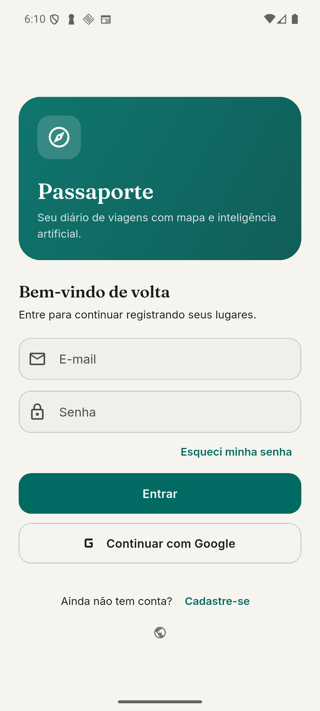
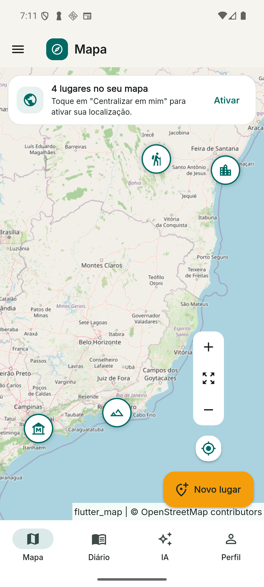
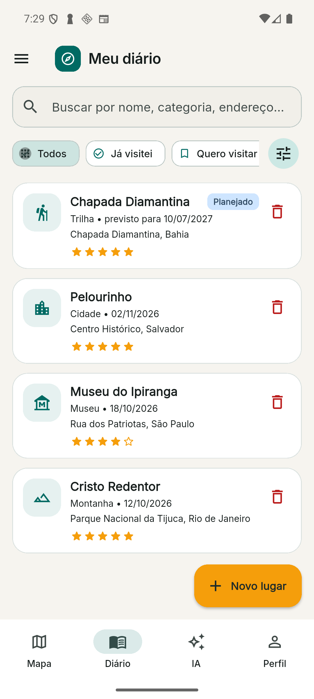
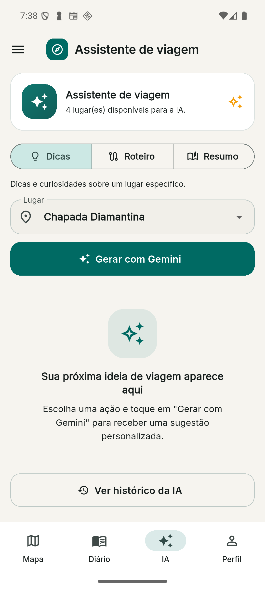

# Passaporte

Aplicativo Flutter para registrar lugares visitados ou desejados, visualizar tudo em um mapa e receber sugestões de viagem geradas pelo Gemini.

Projeto final da disciplina de Tópicos de Desenvolvimento Mobile.

## Links

- **Aplicação web:** https://diario-viagens-tdm-jh.web.app
- **Console do Firebase:** https://console.firebase.google.com/project/diario-viagens-tdm-jh/overview

## Funcionalidades

- **Autenticação com Firebase Auth:** cadastro e login com e-mail/senha, login com
  Google, recuperação de senha e perfil em `users/{uid}`.
- **CRUD completo no Cloud Firestore:** criar, listar, consultar, editar e excluir
  lugares em `users/{uid}/lugares`, com status "Já visitei" / "Quero visitar",
  busca, filtros por status e categoria e ordenação.
- **Mapa e geolocalização:** OpenStreetMap com `flutter_map`, marcadores dos lugares,
  localização atual, seleção de ponto no mapa e preenchimento automático do endereço
  via Nominatim. As coordenadas são salvas no Firestore.
- **IA generativa com Gemini:** dicas sobre um lugar, roteiro de um dia e resumo da
  viagem, com resposta em streaming e Markdown. O histórico de solicitações e
  respostas fica em `users/{uid}/ia_historico`.
- **Extras:** tema claro/escuro/sistema persistido, modo offline com cache do
  Firestore e layout responsivo para web e Android.

## Screenshots

| Login | Mapa |
| --- | --- |
|  |  |

| Diário | Assistente de IA |
| --- | --- |
|  |  |

## Tecnologias

- Flutter 3.44 / Dart 3.12
- Firebase Auth, Cloud Firestore, Firebase AI Logic (Gemini) e App Check
- `flutter_map` + OpenStreetMap, `geolocator`, `latlong2`
- `http` + Nominatim para reverse geocoding
- `connectivity_plus`, `shared_preferences`, `flutter_markdown_plus`
- `google_fonts`, `intl`, `google_sign_in`

## Estrutura do projeto

```text
lib/
  core/         tema, configurações de App Check/IA, categorias, formatadores
  models/       UserModel, Lugar, HistoricoIa
  services/     AuthService, LugarService, HistoricoIaService,
                IaService, LocalizacaoService, GeocodingService,
                ConectividadeService
  screens/      AuthGate, Login, Register, HomeShell, Mapa, Diário,
                Formulário, Detalhe, IA, Histórico da IA, Perfil
  components/   campos, cartão de lugar, estado vazio, seletor no mapa,
                entrada animada, contador animado
```

## Modelo de dados

```text
users/{uid}
  uid, displayName, email, photoUrl

users/{uid}/lugares/{lugarId}
  nome, descricao, categoria, avaliacao,
  dataVisita, latitude, longitude, endereco,
  status ("visitado" | "planejado"), criadoEm, atualizadoEm

users/{uid}/ia_historico/{historicoId}
  tipo ("dicas" | "roteiro" | "resumo"),
  lugarId (opcional), prompt, resposta, criadoEm
```

As regras do Firestore estão em `firestore.rules` e garantem que cada usuário só
acessa os próprios documentos.

## Configuração do Firebase

- Project ID: `diario-viagens-tdm-jh`
- Android applicationId: `com.joaobirkheuer.diarioviagens`
- `lib/firebase_options.dart` e `android/app/google-services.json` já gerados com o
  FlutterFire CLI.

Os tokens de debug do App Check são segredos e ficam em `dart_defines.json`, que não
é versionado. Use `dart_defines.example.json` como modelo. Sem os tokens, o Gemini
não funciona porque o AI Logic exige App Check.

## Como executar

```powershell
flutter pub get

# Web
flutter run -d chrome --dart-define-from-file=dart_defines.json

# Android (emulador ou dispositivo conectado)
flutter run -d <device-id> --dart-define-from-file=dart_defines.json
```

## Build e deploy

```powershell
flutter analyze
flutter test

flutter build web --release --dart-define-from-file=dart_defines.json
flutter build apk --release --dart-define-from-file=dart_defines.json

# APK menor para emulador x64
flutter build apk --release --target-platform android-x64 --dart-define-from-file=dart_defines.json

firebase deploy --only firestore:rules,firestore:indexes
firebase deploy --only hosting
```

Os APKs gerados ficam em `build/app/outputs/flutter-apk/` e não são versionados.

## Conta de demonstração

- **E-mail:** `demo@passaporte.app`
- **Senha:** `Passaporte123!`

A conta tem quatro lugares cadastrados (três visitados e um planejado) e dois
históricos de IA. Também é possível criar uma conta nova ou entrar com Google.

## Observações

- O mapa usa OpenStreetMap, sem chave de API e sem cobrança; a atribuição é exibida.
- O reverse geocoding usa o Nominatim com cache em memória, debounce e User-Agent
  próprio; use com moderação.
- O Gemini usa o Gemini Developer API pelo Firebase AI Logic; o tier gratuito é
  suficiente para o projeto acadêmico.
- O App Check está em modo debug para fins acadêmicos. Em produção, substitua por
  Play Integrity (Android) e reCAPTCHA (Web).
- A localização no Android usa `ACCESS_FINE_LOCATION` e `ACCESS_COARSE_LOCATION`.
- O modo offline mantém o cache do Firestore; os tiles do mapa não são armazenados
  offline nesta versão.
- O tema escolhido pelo usuário é salvo com `shared_preferences`.
